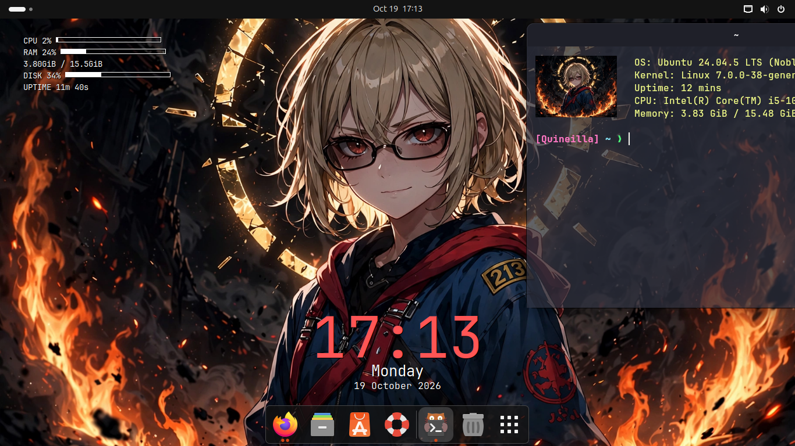

# Nandz Dotfiles 🌃

Ubuntu 24.04 ricing — dark, transparent, anime.



## Isinya

| Komponen | Detail |
|----------|--------|
| Terminal | Kitty — Dracula, JetBrains Mono 12pt, transparan 75%, 720×450 |
| Prompt | Starship — `[Quineilla] ~/path 🌿 branch ❯`, satu baris |
| Splash | Fastfetch + gambar Rayneshia tiap buka terminal |
| Widget | Conky — jam gede + info CPU/RAM/disk, autostart |
| Tema | Colloid-Grey-Dark-Dracula + Papirus-Dark |
| Wallpaper | Rayneshia "ring of fire" |
| Shortcut | Ctrl+Alt+T → Kitty |
| Efek | Burn My Windows (tutup kebakar), Compiz magic lamp |

## Install fresh

```bash
git clone https://github.com/nakgamers/dotfiles.git
cd dotfiles
./install.sh
# reboot
```

Script install: kitty, conky, starship, fastfetch, font, tema Colloid — terus restore semua config, wallpaper, setting GNOME (dconf), dan bashrc.

## Struktur

```
dotfiles/
├── install.sh          # one-shot installer
├── configs/
│   ├── kitty/          # kitty.conf (Dracula, transparan)
│   ├── starship.toml   # prompt [Quineilla]
│   ├── fastfetch/      # splash.sh + gambar Rayneshia
│   ├── conky/          # clock.conf + sysinfo.conf
│   ├── autostart/      # kitty + conky autostart
│   ├── gnome-extensions/
│   └── wallpaper.webp
├── gnome/              # dconf dump
└── screenshots/        # screenshot desktop
```

## Catatan

- X11 (GTX 1050 Ti), belum dites di Wayland.
- Kitty autostart TANPA delay — pakai sleep malah trigger Activities overview pas login.
- `remember_window_size no` di kitty.conf (default Kitty nginget ukuran window terakhir, ngalahin config).
